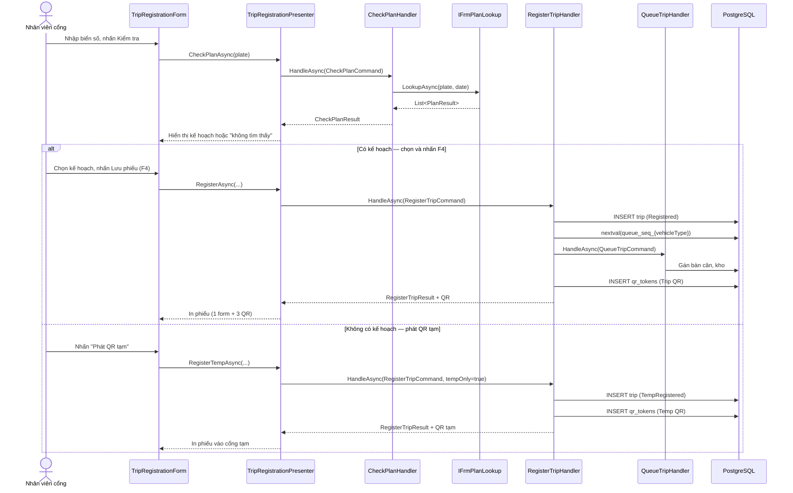
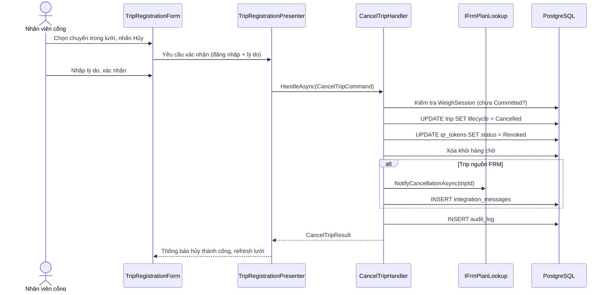

# Tài liệu Thiết kế — trip-registration-redesign

## Overview

Thiết kế lại module đăng tài (UI-02) để phản ánh đúng quy trình thực tế tại nhà máy mía TTC. Bản hiện tại đã đúng kiến trúc (Clean Architecture, MVP, EF Core) nhưng đơn giản hóa nghiệp vụ: nhập tay chứng từ nguồn, không kiểm tra kế hoạch FRM/ERP, không phân loại xe, không xếp hàng, không hủy đăng tài, lưới chuyến thiếu bộ lọc, phiếu in chưa đúng bố cục (1 form + 3 QR).

### Phạm vi thay đổi

- **Trip entity** — thêm VehicleType, QueueSequenceNumber, AssignedWeighbridgeId, AssignedWarehouseId, GateId, và 6 trường mía mở rộng
- **RegisterTripHandler** — tách luồng có/không kế hoạch, gắn thông tin FRM/ERP, gọi xếp hàng
- **ITripNumberGenerator** — thêm sequence riêng theo VehicleType (Container/Truck/Trailer), reset hằng ngày
- **QrToken** — mã hóa Số_thứ_tự, Bàn_cân, Kho vào QR_chuyến; QR_tạm chỉ chứa token
- **CheckPlanHandler** (mới) — gọi IFrmPlanLookup tra kế hoạch theo biển số
- **CancelTripHandler** (mới) — hủy đăng tài, thu hồi QR, gửi FRM
- **QueueTripHandler** (mới) — xếp hàng tự động theo loại xe, gán bàn cân + kho
- **TripRegistrationForm** — viết lại hoàn toàn: form đầy đủ trường, camera, lưới có bộ lọc, phím tắt
- **TripRegistrationQueries** (mới) — dữ liệu lưới với tab lọc
- **CameraViewControl** (mới) — hiển thị luồng camera trên form
- **Database migration** — ALTER TABLE trips, CREATE SEQUENCE per-vehicle-type per-site

### Không thay đổi

- WeighCommitRules, GateDecisionRules, ReconciliationRules — giữ nguyên
- Kiến trúc tổng thể 4 lớp — giữ nguyên
- Module cân (UI-03), đối soát, tích hợp — không ảnh hưởng

---

## Architecture

### Sơ đồ luồng đăng tài mới



### Sơ đồ luồng hủy đăng tài



### Phân lớp theo Clean Architecture

```
Domain
├── Enums/VehicleType (Container, Truck, Trailer)
├── Entities/Trip (thêm trường mới)
├── Entities/QrToken (thêm encoded content)

Application
├── Abstractions/IFrmPlanLookup (interface tra cứu FRM/ERP)
├── Abstractions/ICameraService (interface chụp ảnh)
├── UseCases/Trips/CheckPlanHandler
├── UseCases/Trips/RegisterTripHandler (redesign)
├── UseCases/Trips/CancelTripHandler
├── UseCases/Trips/QueueTripHandler
├── UseCases/Trips/ITripNumberGenerator (thêm overload per-vehicle-type)
├── Queries/TripRegistrationQueries (lưới + bộ lọc)

Infrastructure
├── Repositories/SequentialTripNumberGenerator (thêm sequence per-vehicle-type)
├── Repositories/FrmPlanLookupAdapter (implement IFrmPlanLookup)
├── Queries/EfTripRegistrationQueries
├── Persistence/Migrations/AddTripRegistrationRedesign

WinForms
├── Forms/TripRegistrationForm (viết lại)
├── Controls/CameraViewControl
├── Presenters/TripRegistrationPresenter
```

---

## Components and Interfaces

### 1. IFrmPlanLookup — Tra cứu kế hoạch FRM/ERP

```csharp
// Application/Abstractions/IFrmPlanLookup.cs
namespace TTC.Weighing.Application.Abstractions;

/// <summary>
/// Tra cứu kế hoạch mía (FRM) hoặc vật tư (ERP) theo biển số.
/// Infrastructure implement bằng HTTP client gọi API ngoài.
/// </summary>
public interface IFrmPlanLookup
{
    /// <summary>Tìm kế hoạch khớp biển số trong ngày vận hành.</summary>
    Task<PlanLookupResult> LookupAsync(
        Guid siteId, string plate, DateTimeOffset operatingDate, CancellationToken ct = default);

    /// <summary>Gửi thông báo hủy đến FRM khi hủy đăng tài.</summary>
    Task<IntegrationSendResult> NotifyCancellationAsync(
        Guid siteId, Guid tripId, string? referenceTripNo, string reason,
        string correlationId, CancellationToken ct = default);
}

public sealed record PlanLookupResult(
    bool IsSuccess,
    IReadOnlyList<PlanEntry> Plans,
    string? ErrorMessage);

public sealed record PlanEntry(
    string Source,           // "FRM" hoặc "ERP"
    string ReferenceNo,      // Mã lệnh đốn hoặc Shipment
    string? CommodityType,   // Loại hàng
    string? OwnerOrCustomer, // Chủ mía hoặc khách hàng
    string? WarehouseCode,   // Kho đích
    string? SugarcaneType,
    string? SugarcaneVariety,
    string? HarvestMethod,
    string? Station,
    string? CropSeason);

public sealed record IntegrationSendResult(
    bool IsSuccess,
    IntegrationMessageStatus Status,
    string? ErrorMessage);
```

### 2. ICameraService — Chụp ảnh camera cổng

```csharp
// Application/Abstractions/ICameraService.cs
namespace TTC.Weighing.Application.Abstractions;

/// <summary>
/// Dịch vụ camera tại cổng. Trạng thái camera không chặn đăng tài.
/// </summary>
public interface ICameraService
{
    /// <summary>Chụp ảnh từ camera, trả về đường dẫn ảnh lưu trữ. Null nếu camera offline.</summary>
    Task<string?> CaptureSnapshotAsync(
        Guid gateId, string cameraPosition, CancellationToken ct = default);

    /// <summary>Kiểm tra trạng thái camera.</summary>
    Task<CameraStatus> GetStatusAsync(
        Guid gateId, string cameraPosition, CancellationToken ct = default);
}

public sealed record CameraStatus(bool IsOnline, string? LastError);
```

### 3. CheckPlanHandler — Kiểm tra kế hoạch

```csharp
// Application/UseCases/Trips/CheckPlanHandler.cs

public sealed record CheckPlanCommand(
    Guid SiteId,
    string Plate,
    string CorrelationId);

public sealed record CheckPlanResult(
    bool IsSuccess,
    IReadOnlyList<PlanEntry> Plans,
    string? ErrorMessage);

/// <summary>
/// R-001 — Kiểm tra biển số trong kế hoạch FRM/ERP trước khi đăng tài.
/// Lỗi kết nối FRM/ERP chặn đăng tài chính thức (Req 1.4).
/// </summary>
public sealed class CheckPlanHandler(
    IFrmPlanLookup planLookup,
    IClock clock,
    ICurrentUser user)
{
    public const string RequiredPermission = "trip.register";

    public async Task<CheckPlanResult> HandleAsync(
        CheckPlanCommand cmd, CancellationToken ct = default)
    {
        if (!user.HasPermission(RequiredPermission, cmd.SiteId))
            return new(false, [], "Không có quyền tra cứu tại nhà máy này.");

        var result = await planLookup.LookupAsync(
            cmd.SiteId, cmd.Plate, clock.UtcNow, ct);

        return new(result.IsSuccess, result.Plans, result.ErrorMessage);
    }
}
```

### 4. RegisterTripHandler — Redesign

Redesign handler hiện tại để hỗ trợ:
- Nhận thông tin kế hoạch đã chọn (PlanEntry) thay vì chỉ ReferenceTripNo
- Gắn VehicleType, thông tin mía mở rộng
- Gọi QueueTripHandler khi đăng tài chính thức (Registered)
- Mã hóa QR_chuyến chứa Số_thứ_tự + Bàn_cân + Kho

```csharp
// RegisterTripCommand mở rộng
public sealed record RegisterTripCommand(
    Guid SiteId,
    Guid GateId,
    Guid WorkflowProfileId,
    int WorkflowProfileVersion,
    // Thông tin kế hoạch (từ CheckPlanHandler)
    string? ReferenceTripNo,
    string? PlanSource,           // "FRM" hoặc "ERP"
    string? CommodityType,
    string? OwnerOrCustomer,
    string? WarehouseCode,
    // Thông tin xe
    string? TractorPlate,
    string? TrailerPlate,
    string? DriverRef,
    VehicleType? VehicleType,
    // Thông tin mía mở rộng (từ FRM)
    string? SugarcaneType,
    string? SugarcaneVariety,
    string? SugarcaneOwner,
    string? HarvestMethod,
    string? Station,
    string? CropSeason,
    // Điều khiển
    string CorrelationId,
    bool IssueTemporaryQrOnly = false);

public sealed record RegisterTripResult(
    bool IsSuccess,
    Guid? TripId,
    string? TripNo,
    int? QueueSequenceNumber,
    string? QrToken,
    QrTokenType? QrType,
    Guid? AssignedWeighbridgeId,
    Guid? AssignedWarehouseId,
    string? FailureReason);
```

**Luồng xử lý chính:**

1. Kiểm tra quyền `trip.register` cho site
2. Validate hồ sơ nghiệp vụ (profile)
3. Xác định luồng: `IssueTemporaryQrOnly || !hasSourceReference` → TempRegistered, ngược lại → Registered
4. Sinh TripNo (sequence chung như hiện tại)
5. Nếu Registered + có VehicleType cho mía nhập:
   - Gọi `IQueueSequenceGenerator.NextAsync(siteId, vehicleType)` → Số_thứ_tự
   - Gọi `QueueTripHandler` → gán AssignedWeighbridgeId, AssignedWarehouseId
6. Tạo Trip entity với toàn bộ trường mới
7. Tạo QrToken: QR_chuyến mã hóa (tokenHash, Số_thứ_tự, bridgeCode, warehouseCode), QR_tạm chỉ tokenHash
8. Chụp ảnh camera vào (không chặn nếu lỗi)
9. Lưu audit log
10. SaveChanges trong một transaction

### 5. CancelTripHandler — Hủy đăng tài

```csharp
public sealed record CancelTripCommand(
    Guid TripId,
    int ExpectedVersion,
    string Reason,
    string ConfirmUserId,  // Xác nhận lại danh tính
    string CorrelationId);

public sealed record CancelTripResult(
    bool IsSuccess,
    string? FailureReason,
    IntegrationMessageStatus? FrmNotifyStatus);
```

**Luồng:**
1. Kiểm tra quyền `trip.cancel`
2. Load trip với version check (optimistic concurrency)
3. Kiểm tra Lifecycle ∈ {TempRegistered, Registered} — từ chối nếu đã cân
4. Kiểm tra chưa có WeighSession Committed — từ chối nếu có
5. Chuyển Lifecycle → Cancelled
6. Thu hồi tất cả QrToken → Revoked
7. Giải phóng khỏi hàng chờ (xóa QueueSequenceNumber assignment)
8. Nếu nguồn FRM → gọi `IFrmPlanLookup.NotifyCancellationAsync`, xử lý UNKNOWN theo R-024
9. Audit log đầy đủ

### 6. QueueTripHandler — Xếp hàng tự động

```csharp
public sealed record QueueTripCommand(
    Guid TripId,
    Guid SiteId,
    VehicleType VehicleType,
    string? PreferredWarehouseCode);

public sealed record QueueTripResult(
    bool IsSuccess,
    Guid? AssignedWeighbridgeId,
    Guid? AssignedWarehouseId,
    string? FailureReason);
```

**Luồng:**
1. Lấy danh sách bàn cân khả dụng cho site (`IsOutOfService = false`)
2. Phân bổ bàn cân theo quy tắc:
   - Ưu tiên bàn cân có ít chuyến chờ nhất (load balancing)
   - Nếu không có bàn cân khả dụng: vẫn thành công nhưng `AssignedWeighbridgeId = null`
3. Gán kho đích từ kế hoạch nguồn hoặc cấu hình mặc định
4. Cập nhật Trip: `AssignedWeighbridgeId`, `AssignedWarehouseId`

### 7. IQueueSequenceGenerator — Số thứ tự theo loại xe

```csharp
// Application/UseCases/Trips/ITripNumberGenerator.cs — mở rộng
public interface IQueueSequenceGenerator
{
    /// <summary>
    /// Cấp số thứ tự tự tăng theo loại xe, tách riêng per-site per-day.
    /// Dùng PostgreSQL sequence, reset hằng ngày.
    /// </summary>
    Task<int> NextAsync(Guid siteId, VehicleType vehicleType, CancellationToken ct = default);
}
```

**Implementation (Infrastructure):**

```sql
-- 3 sequence riêng, reset hằng ngày bằng scheduled job hoặc application logic
CREATE SEQUENCE IF NOT EXISTS queue_seq_container START 1 INCREMENT 1;
CREATE SEQUENCE IF NOT EXISTS queue_seq_truck START 1 INCREMENT 1;
CREATE SEQUENCE IF NOT EXISTS queue_seq_trailer START 1 INCREMENT 1;
```

Sử dụng bảng `queue_sequence_tracker` để quản lý reset hằng ngày:

```sql
CREATE TABLE queue_sequence_tracker (
    site_id uuid NOT NULL,
    vehicle_type varchar(20) NOT NULL,
    current_date date NOT NULL,
    last_value int NOT NULL DEFAULT 0,
    PRIMARY KEY (site_id, vehicle_type, current_date)
);
```

Dùng `INSERT ... ON CONFLICT DO UPDATE SET last_value = last_value + 1 RETURNING last_value` để đảm bảo atomic increment không trùng lặp khi nhiều trạm đồng thời.

### 8. TripRegistrationQueries — Lưới danh sách chuyến

```csharp
// Application/Queries/TripRegistrationQueries.cs

public sealed record TripRegistrationRow(
    Guid TripId,
    int Version,
    string TripNo,
    string? ShipmentNo,
    string? Plate,
    int? QueueSequenceNumber,
    string? DriverRef,
    DateTimeOffset? EntryTime,
    DateTimeOffset? ExitTime,
    string? Transporter,
    string? CustomerOrSupplier,
    string? Commodity,
    TripLifecycle Lifecycle,
    string? VehicleType);

public sealed record TripRegistrationFilter
{
    public DateTimeOffset? FromUtc { get; init; }
    public DateTimeOffset? ToUtc { get; init; }
    public TripGridTab Tab { get; init; } = TripGridTab.InFactory;
}

public enum TripGridTab
{
    InFactory,   // Trong nhà máy: đã vào chưa ra
    Exited,      // Đã ra
    Cancelled    // Phiếu đã hủy
}

public interface ITripRegistrationQueries
{
    Task<IReadOnlyList<TripRegistrationRow>> ListAsync(
        Guid siteId, TripRegistrationFilter filter, CancellationToken ct = default);
}
```

### 9. QrToken — Mã hóa nội dung QR

QR_chuyến chứa JSON mã hóa Base64:
```json
{
  "t": "<token_hash_prefix_8_chars>",
  "s": 42,
  "b": "BC-01",
  "w": "KHO-A"
}
```

Trong đó:
- `t` — 8 ký tự đầu của token hash, dùng để lookup nhanh
- `s` — Số_thứ_tự (QueueSequenceNumber)
- `b` — Mã bàn cân (AssignedWeighbridgeId → Code)
- `w` — Mã kho (AssignedWarehouseId → Code)

QR_tạm chỉ chứa:
```json
{
  "t": "<token_hash_prefix_8_chars>"
}
```

Nội dung QR không chứa dữ liệu nhạy cảm. Token đầy đủ được lưu dưới dạng hash trong DB — QR chỉ chứa prefix để lookup, server validate hash đầy đủ.

**Phiếu đăng tài gồm 3 QR riêng biệt:**
1. QR cho điểm cân lần 1 (FirstWeight)
2. QR cho điểm cân lần 2 (SecondWeight)
3. QR cho cổng ra (GateOut)

Cả 3 QR chứa cùng nội dung nhưng in tại 3 vị trí khác nhau trên phiếu để tài xế cắt/xé đưa tại mỗi điểm.

### 10. TripRegistrationForm — Bố cục mới

```
┌─────────────────────────────────────────────────────────┐
│ UI-02 — Đăng tài                                        │
├───────────────────────┬─────────────────────────────────┤
│ [Form đăng tài]       │ [Camera Vào]  [Camera Ra]       │
│ Cổng: ______          │                                 │
│ Biển số: ______ [KT]  │                                 │
│ Số đăng tài: (auto)   │                                 │
│ Lệnh đốn/Ship: ___   ├─────────────────────────────────┤
│ Ngày giờ: (auto)      │ [Panel thông báo]               │
│ Loại xe: [▼]          │ 09:15:30  Kiểm tra 51A-123.45  │
│ Loại mía: ___         │ 09:15:32  Tìm thấy 1 kế hoạch  │
│ Giống mía: ___        │ 09:15:40  Đăng tài #TT-001     │
│ Chủ mía: ___          │ ...                             │
│ Thu hoạch: ___        │                                 │
│ Trạm: ___             │                                 │
│ Vụ mùa: ___           │                                 │
│ Ghi chú: ___          │                                 │
├───────────────────────┴─────────────────────────────────┤
│ [Lưu phiếu F4] [In phiếu F5] [Xác nhận F6] [Mới Esc]  │
├─────────────────────────────────────────────────────────┤
│ Tabs: [Trong NM] [Đã ra] [Đã hủy]  Từ ngày: ___ → ___ │
│ ┌─────┬──────┬──────┬──────┬───┬──────┬─────┬────┬────┐ │
│ │ STT │ Trip │ Ship │ BSố │ # │ TXế  │ Vào │ Ra │ KH │ │
│ ├─────┼──────┼──────┼──────┼───┼──────┼─────┼────┼────┤ │
│ │ 001 │ T-01 │ S-01 │ 51A  │ 1 │ Cont │ 9:1 │    │ ABC│ │
│ │ ... │      │      │      │   │      │     │    │    │ │
│ └─────┴──────┴──────┴──────┴───┴──────┴─────┴────┴────┘ │
├─────────────────────────────────────────────────────────┤
│ Server: 🟢  Barcode: 🟢  LPR: 🟡  Camera: 🟢          │
└─────────────────────────────────────────────────────────┘
```

**Phím tắt:**
| Phím | Hành động |
|------|-----------|
| F4 | Lưu phiếu (đăng tài) |
| F5 | In phiếu (in lại) |
| F6 | Xác nhận (confirm chọn kế hoạch) |
| Esc | Làm mới form |

### 11. TripRegistrationPresenter — Presenter pattern

```csharp
// WinForms/Presenters/TripRegistrationPresenter.cs
public sealed class TripRegistrationPresenter
{
    // Dependencies: CheckPlanHandler, RegisterTripHandler,
    //              CancelTripHandler, ITripRegistrationQueries,
    //              ICameraService, ISiteContext, ICurrentUser

    Task<CheckPlanResult> CheckPlanAsync(string plate);
    Task<RegisterTripResult> RegisterAsync(RegisterTripCommand cmd);
    Task<RegisterTripResult> RegisterTempAsync(RegisterTripCommand cmd);
    Task<CancelTripResult> CancelAsync(CancelTripCommand cmd);
    Task<IReadOnlyList<TripRegistrationRow>> LoadGridAsync(TripRegistrationFilter filter);
    Task<CameraStatus> GetCameraStatusAsync(string position);
}
```

Form gọi Presenter, Presenter gọi Application handlers — Form không trực tiếp gọi Domain hay Infrastructure.

---

## Data Models

### Trip entity — Các trường mới

```csharp
public class Trip : AuditableEntity
{
    // ... các trường hiện tại giữ nguyên ...

    // --- Trường mới cho redesign ---

    /// <summary>Loại xe: Container, Truck, Trailer. Null khi hồ sơ không bắt buộc.</summary>
    public VehicleType? VehicleType { get; set; }

    /// <summary>Số thứ tự trong hàng chờ theo loại xe, riêng biệt với TripNo.</summary>
    public int? QueueSequenceNumber { get; set; }

    /// <summary>Bàn cân được gán khi xếp hàng.</summary>
    public Guid? AssignedWeighbridgeId { get; set; }

    /// <summary>Kho đích được gán từ kế hoạch nguồn.</summary>
    public Guid? AssignedWarehouseId { get; set; }

    /// <summary>Cổng đăng tài.</summary>
    public Guid? GateId { get; set; }

    // --- Thông tin mía mở rộng (từ FRM) ---
    public string? SugarcaneType { get; set; }      // Loại mía
    public string? SugarcaneVariety { get; set; }    // Giống mía
    public string? SugarcaneOwner { get; set; }      // Chủ mía
    public string? HarvestMethod { get; set; }       // Hình thức thu hoạch
    public string? Station { get; set; }             // Trạm
    public string? CropSeason { get; set; }          // Vụ mùa
}
```

### VehicleType enum — Mới

```csharp
// Domain/Enums/DomainEnums.cs — thêm
public enum VehicleType
{
    Container,
    Truck,
    Trailer
}
```

### QrToken entity — Thêm trường nội dung mã hóa

```csharp
public class QrToken : AuditableEntity
{
    // ... các trường hiện tại giữ nguyên ...

    /// <summary>
    /// Nội dung mã hóa trong QR (JSON Base64).
    /// QR_chuyến: token prefix + số thứ tự + bàn cân + kho.
    /// QR_tạm: chỉ token prefix.
    /// </summary>
    public string? EncodedContent { get; set; }
}
```

### Database Migration

```sql
-- Migration: AddTripRegistrationRedesign

-- 1. Thêm cột cho trips
ALTER TABLE trips ADD COLUMN vehicle_type varchar(20);
ALTER TABLE trips ADD COLUMN queue_sequence_number int;
ALTER TABLE trips ADD COLUMN assigned_weighbridge_id uuid;
ALTER TABLE trips ADD COLUMN assigned_warehouse_id uuid;
ALTER TABLE trips ADD COLUMN gate_id uuid;
ALTER TABLE trips ADD COLUMN sugarcane_type varchar(100);
ALTER TABLE trips ADD COLUMN sugarcane_variety varchar(100);
ALTER TABLE trips ADD COLUMN sugarcane_owner varchar(200);
ALTER TABLE trips ADD COLUMN harvest_method varchar(100);
ALTER TABLE trips ADD COLUMN station varchar(100);
ALTER TABLE trips ADD COLUMN crop_season varchar(50);

-- 2. Thêm cột cho qr_tokens
ALTER TABLE qr_tokens ADD COLUMN encoded_content text;

-- 3. Bảng theo dõi sequence hàng chờ (reset hằng ngày)
CREATE TABLE queue_sequence_tracker (
    site_id uuid NOT NULL,
    vehicle_type varchar(20) NOT NULL,
    operating_date date NOT NULL,
    last_value int NOT NULL DEFAULT 0,
    PRIMARY KEY (site_id, vehicle_type, operating_date)
);

-- 4. Index hỗ trợ lưới đăng tài
CREATE INDEX idx_trips_vehicle_type ON trips (site_id, vehicle_type)
    WHERE deleted_at IS NULL;
CREATE INDEX idx_trips_gate_id ON trips (gate_id)
    WHERE deleted_at IS NULL;
CREATE INDEX idx_trips_queue_seq ON trips (site_id, vehicle_type, queue_sequence_number)
    WHERE deleted_at IS NULL AND queue_sequence_number IS NOT NULL;

-- 5. Down() migration
-- ALTER TABLE trips DROP COLUMN vehicle_type, queue_sequence_number, ...
-- ALTER TABLE qr_tokens DROP COLUMN encoded_content;
-- DROP TABLE queue_sequence_tracker;
-- DROP INDEX idx_trips_vehicle_type, idx_trips_gate_id, idx_trips_queue_seq;
```

### Tương thích ngược

- Tất cả cột mới đều nullable — Trip cũ không bị ảnh hưởng
- VehicleType null khi hồ sơ không yêu cầu phân loại (ví dụ vật tư)
- QueueSequenceNumber null khi chưa xếp hàng hoặc QR tạm
- EncodedContent null cho QrToken cũ (server resolve bằng TokenHash)

---


## Correctness Properties

*Một property là đặc tính hoặc hành vi phải luôn đúng trong mọi trường hợp thực thi hợp lệ của hệ thống — là phát biểu hình thức về những gì hệ thống phải làm. Properties là cầu nối giữa đặc tả con người đọc được và đảm bảo đúng đắn máy có thể kiểm chứng.*

### Property 1: Quy tắc bắt buộc VehicleType theo loại hồ sơ

*Cho mọi* RegisterTripCommand với hồ sơ nghiệp vụ mía nhập (Inbound sugarcane), nếu VehicleType là null thì handler phải trả IsSuccess = false. Ngược lại, *cho mọi* command với hồ sơ không phải mía nhập, VehicleType null vẫn cho đăng tài thành công (các điều kiện khác hợp lệ).

**Validates: Requirements 2.1, 2.4**

### Property 2: Số thứ tự hàng chờ tăng đơn điệu

*Cho mọi* chuỗi N lần gọi `IQueueSequenceGenerator.NextAsync` với cùng bộ (siteId, vehicleType, operatingDate), dãy số trả về phải tăng đơn điệu nghiêm ngặt (mỗi giá trị lớn hơn giá trị trước đó).

**Validates: Requirements 2.2**

### Property 3: Nội dung mã hóa QR round-trip

*Cho mọi* QrToken loại Trip tạo bởi RegisterTripHandler với QueueSequenceNumber S, mã Bàn_cân B, mã Kho W: decode(EncodedContent) phải chứa đúng các giá trị S, B, W. *Cho mọi* QrToken loại Temp: decode(EncodedContent) chỉ chứa token prefix và không chứa Số_thứ_tự, Bàn_cân, Kho.

**Validates: Requirements 2.5, 3.3, 8.2**

### Property 4: Lifecycle đúng theo luồng đăng tài

*Cho mọi* RegisterTripCommand hợp lệ: nếu có kế hoạch nguồn (IssueTemporaryQrOnly = false, ReferenceTripNo != null) thì Trip.Lifecycle phải là Registered; nếu không có kế hoạch hoặc IssueTemporaryQrOnly = true thì Trip.Lifecycle phải là TempRegistered.

**Validates: Requirements 3.1, 4.1**

### Property 5: Xếp hàng tự động cho trip Registered

*Cho mọi* trip đăng tài thành công với Lifecycle = Registered và VehicleType != null: nếu tồn tại ít nhất một bàn cân khả dụng (IsOutOfService = false) tại site thì AssignedWeighbridgeId phải khác null; QueueSequenceNumber phải khác null và > 0.

**Validates: Requirements 3.2, 9.1, 9.2**

### Property 6: Chuyển đổi TempRegistered sang Registered

*Cho mọi* trip có Lifecycle = TempRegistered, khi nhận xác nhận kế hoạch từ FRM: trip.Lifecycle phải chuyển thành Registered, mọi QrToken cũ loại Temp phải có Status = Revoked, và phải có ít nhất một QrToken mới loại Trip với Status = Issued chứa Số_thứ_tự.

**Validates: Requirements 4.3, 4.5**

### Property 7: Điều kiện và hệ quả hủy đăng tài

*Cho mọi* CancelTripCommand:
- Nếu trip.Lifecycle ∈ {TempRegistered, Registered} VÀ không có WeighSession Committed → hủy thành công, trip.Lifecycle = Cancelled, mọi QrToken.Status = Revoked
- Nếu trip có WeighSession Committed → hủy thất bại, trip.Lifecycle giữ nguyên

**Validates: Requirements 5.1, 5.3, 5.5, 9.3**

### Property 8: Bộ lọc lưới chuyến đúng logic

*Cho mọi* tập trips tại một site và bộ lọc TripRegistrationFilter:
- Tab InFactory → kết quả chỉ chứa trips có Lifecycle ∈ {TempRegistered, Registered, InProgress, WeighingCompleted, Reconciled, Posted}
- Tab Cancelled → kết quả chỉ chứa trips có Lifecycle = Cancelled
- Tab Exited → kết quả chỉ chứa trips có Lifecycle = Closed
- Khoảng ngày [from, to) → mọi trip trong kết quả có CreatedAt ∈ [from, to)

**Validates: Requirements 7.2, 7.3**

### Property 9: Trip entity persistence round-trip

*Cho mọi* Trip hợp lệ với bất kỳ tổ hợp giá trị của các trường mới (VehicleType, QueueSequenceNumber, AssignedWeighbridgeId, AssignedWarehouseId, GateId, SugarcaneType, SugarcaneVariety, SugarcaneOwner, HarvestMethod, Station, CropSeason — bao gồm null), sau khi lưu vào DB và đọc lại thì mọi trường phải giữ nguyên giá trị. Đặc biệt, Trip cũ với tất cả trường mới null vẫn load và IsOperable trả đúng kết quả.

**Validates: Requirements 11.1, 11.2, 11.3, 11.4, 11.5, 11.6**

---

## Error Handling

### Lỗi kết nối FRM/ERP (Req 1.4)

- Timeout hoặc lỗi mạng khi gọi `IFrmPlanLookup.LookupAsync` → trả `PlanLookupResult.IsSuccess = false`
- UI hiển thị thông báo lỗi cụ thể (tên hệ thống + mã lỗi)
- **Chặn** đăng tài chính thức (Registered) — chỉ cho phép QR tạm
- Cấu hình timeout per-site trong `appsettings.json`

### Lỗi gửi FRM khi hủy (Req 5.4)

- Gọi `IFrmPlanLookup.NotifyCancellationAsync` thất bại → tạo `IntegrationMessage` với status UNKNOWN
- Trip vẫn Cancelled (không rollback) — theo nguyên tắc R-024
- Retry xử lý bởi `IntegrationMonitorForm` (UI-08) — không auto-retry

### Lỗi máy in (Req 8.5)

- Đăng tài đã lưu DB thành công → không rollback vì lỗi in
- Thông báo lỗi in trên panel notification
- Cho phép in lại bất kỳ lúc nào bằng F5 (ghi audit "REPRINT")

### Lỗi camera (Req 10.3)

- Camera offline → hiển thị "Mất kết nối" trên khung hình tương ứng
- **Không chặn** đăng tài — ảnh snapshot null, ghi nhận trên audit log
- Trạng thái camera hiển thị trên thanh trạng thái (🟢/🔴)

### Lỗi concurrency

- Trip version mismatch khi hủy → trả `FailureReason` yêu cầu reload
- Sequence contention trên `queue_sequence_tracker` → PostgreSQL `INSERT ON CONFLICT` xử lý atomic
- Nhiều trạm đăng tài đồng thời → sequence DB đảm bảo không trùng

### Lỗi nghiệp vụ

| Tình huống | Hành vi |
|------------|---------|
| Profile chưa duyệt/hết hiệu lực | Từ chối đăng tài, hiện lý do |
| VehicleType null cho mía nhập | Từ chối đăng tài, yêu cầu chọn loại xe |
| Hủy trip đã cân | Từ chối hủy, hiện "Chuyến đã bắt đầu cân" |
| QR tạm quét tại bàn cân | Không cho phép cân chính thức (R-004) |
| Không có bàn cân khả dụng | Đăng tài thành công, AssignedWeighbridgeId = null, thông báo |

---

## Testing Strategy

### Kiểm thử đơn vị (Unit Tests)

Tập trung vào logic nghiệp vụ thuần trong Application layer:

| Handler/Component | Test cases |
|-------------------|------------|
| CheckPlanHandler | Quyền thiếu, lookup thành công/thất bại, nhiều kế hoạch |
| RegisterTripHandler | Luồng có kế hoạch, luồng QR tạm, VehicleType validation, profile invalid |
| CancelTripHandler | Hủy thành công, từ chối khi đã cân, version mismatch, thiếu reason |
| QueueTripHandler | Gán bàn cân, load balancing, không có bàn cân |
| QrTokenFactory | Encode/decode QR content, hash consistency |
| QueueSequenceGenerator | Tăng đơn điệu, reset ngày mới |
| TripRegistrationQueries | Filter InFactory/Exited/Cancelled, khoảng ngày |

### Kiểm thử thuộc tính (Property-Based Tests)

Sử dụng thư viện **FsCheck** (NuGet: FsCheck, FsCheck.Xunit) — thư viện PBT phổ biến nhất cho .NET.

Cấu hình: tối thiểu 100 iterations mỗi property test.

| Property | Mô tả | Tag |
|----------|-------|-----|
| Property 1 | VehicleType validation rule | Feature: trip-registration-redesign, Property 1: VehicleType bắt buộc cho mía nhập |
| Property 2 | Queue sequence monotonic | Feature: trip-registration-redesign, Property 2: Sequence tăng đơn điệu |
| Property 3 | QR content round-trip | Feature: trip-registration-redesign, Property 3: QR encode/decode round-trip |
| Property 4 | Registration lifecycle | Feature: trip-registration-redesign, Property 4: Lifecycle đúng theo luồng |
| Property 5 | Queue assignment | Feature: trip-registration-redesign, Property 5: Xếp hàng tự động |
| Property 6 | Temp-to-Registered promotion | Feature: trip-registration-redesign, Property 6: Chuyển TempRegistered → Registered |
| Property 7 | Cancellation logic | Feature: trip-registration-redesign, Property 7: Hủy đăng tài |
| Property 8 | Grid filter correctness | Feature: trip-registration-redesign, Property 8: Bộ lọc lưới |
| Property 9 | Trip persistence round-trip | Feature: trip-registration-redesign, Property 9: Trip entity round-trip |

### Kiểm thử tích hợp (Integration Tests)

| Kịch bản | Mục đích |
|-----------|----------|
| Concurrent sequence generation | Nhiều thread gọi NextAsync đồng thời, verify no duplicates |
| Full registration flow E2E | Lookup → Register → Queue → Print, verify DB state |
| FRM cancellation notification | Gửi hủy đến FRM mock, verify IntegrationMessage |
| Camera snapshot capture | Chụp ảnh khi đăng tài, verify file saved |
| Migration Up/Down | Verify migration không mất dữ liệu Trip cũ |

### Kiểm thử thủ công (Manual/UI)

- Form layout đúng wireframe (camera, lưới, phím tắt)
- Phiếu in đúng bố cục 1 form + 3 QR
- Phím tắt F4/F5/F6/Esc hoạt động
- Thanh trạng thái cập nhật đúng
- Lưới tự refresh khi có thay đổi
