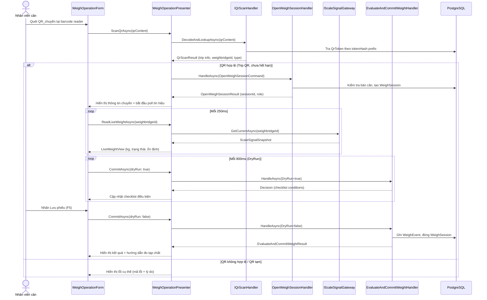
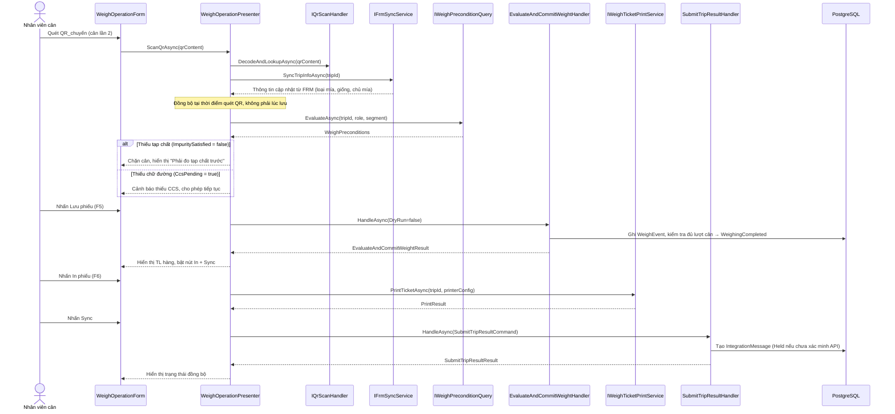
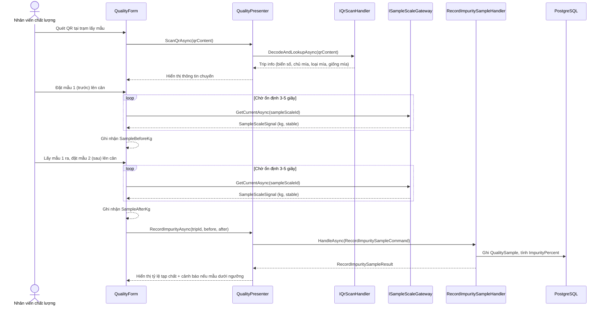
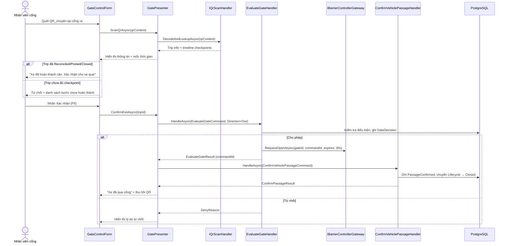

# Tài liệu Thiết kế — weighing-workflow-integration

## Overview

Tích hợp luồng cân end-to-end cho hệ thống cân hợp nhất TTC, kết nối các module đã có (cân, chất lượng, kho, cổng, đối soát, tích hợp) thành quy trình liền mạch trên giao diện WinForms. Phạm vi bao gồm:

1. **Luồng cân lần 1** — QR scan → auto-load trip → hiển thị số cân realtime → chốt cân (F5)
2. **Luồng đo tạp chất** — QR scan → auto-weigh mẫu trước/sau → tính tạp chất
3. **Luồng chữ đường (CCS)** — tiếp nhận từ FRM hoặc nhập tay, hỗ trợ đến sau cân
4. **Luồng cân lần 2** — kiểm tra điều kiện trước, đồng bộ FRM, chốt cân, tính trọng lượng hàng
5. **In phiếu cân** — in sau cân lần 2 với template riêng theo nhà máy
6. **Vào/ra kho** — MeasurementSessionForm redesign, QR scan, checkpoint tracking
7. **Cổng ra** — xác minh hoàn thành, mở barie có thời hạn
8. **Đồng bộ ERP** — manual sync, UNKNOWN handling, auto-retry khi idempotent
9. **Ghép xe** — phân bổ trọng lượng cho nhiều chủ mía
10. **Cân lại sau sự cố** — tạo lượt cân mới liên kết supersedes_id
11. **Nhập tay số cân** — có quyền, lý do, phê duyệt
12. **Cập nhật loại mía từ FRM** — đồng bộ SugarcaneType
13. **Giám sát thiết bị** — thanh trạng thái trên form cân

### Phạm vi thay đổi

- **WeighOperationForm (UI-03)** — bổ sung: QR scan handler, FRM sync khi cân lần 2, nút In phiếu (F6), nút Sync ERP, checklist điều kiện, thanh trạng thái thiết bị realtime, hỗ trợ nhập tay
- **WeighOperationPresenter** — mở rộng: thêm method scan QR, sync FRM, in phiếu, sync ERP, nhập tay, cân lại
- **MeasurementSessionForm (UI-04)** — redesign: QR scan vào/ra kho, checkpoint tracking, danh sách xe trong kho
- **QualityForm (UI-05)** — mở rộng: auto-weigh tạp chất, tiếp nhận CCS
- **GateControlForm (UI-11)** — bổ sung: xác minh hoàn thành trước khi cho ra, thu hồi QR
- **PrintHelper** (mới) — in phiếu cân với template theo nhà máy
- **IWeighTicketPrintService** (mới) — interface in phiếu
- **IFrmSyncService** (mới) — đồng bộ thông tin chuyến từ FRM tại thời điểm quét QR
- **IQrScanHandler** (mới) — xử lý quét QR tại các form, decode + validate + lookup trip
- **IDeviceStatusMonitor** (mới) — giám sát trạng thái thiết bị realtime
- **ISampleScaleGateway** (mới) — gateway đầu cân mẫu tạp chất
- **UpdateSugarcaneTypeHandler** (mới) — cập nhật loại mía từ FRM
- **Database migration** — thêm bảng `weigh_tickets`, cột `ticket_number` trên trips

### Không thay đổi

- Domain rules: WeighCommitRules, GateDecisionRules, ReconciliationRules, ImpurityCalculator, NetWeightCalculator — giữ nguyên
- Application handlers cốt lõi: EvaluateAndCommitWeightHandler, OpenWeighSessionHandler, GateHandlers, QualityHandlers, MeasurementSessionHandlers, ReconcileTripHandler, AllocateTripHandler, SubmitTripResultHandler, ExceptionHandlers — giữ nguyên logic, chỉ tích hợp vào UI
- Kiến trúc tổng thể 4 lớp — giữ nguyên

---

## Architecture

### Sơ đồ luồng cân lần 1



### Sơ đồ luồng cân lần 2 + In phiếu + Sync



### Sơ đồ luồng đo tạp chất tự động



### Sơ đồ luồng cổng ra



### Phân lớp theo Clean Architecture

```
Domain (không thay đổi)
├── Entities/ — Trip, WeighSession, WeighEvent, QualitySample, MeasurementSession, ...
├── Rules/ — WeighCommitRules, ImpurityCalculator, NetWeightCalculator, ReconciliationRules, ...
├── Enums/ — TripLifecycle, WeightRole, CheckpointType, ...

Application
├── Abstractions/
│   ├── IQrScanHandler (MỚI) — decode QR + lookup trip + validate
│   ├── IFrmSyncService (MỚI) — đồng bộ thông tin chuyến từ FRM
│   ├── IWeighTicketPrintService (MỚI) — in phiếu cân
│   ├── ISampleScaleGateway (MỚI) — gateway đầu cân mẫu
│   ├── IDeviceStatusMonitor (MỚI) — giám sát trạng thái thiết bị
│   ├── IWeighWorkspaceProvider (đã có) — cung cấp workspace cân
│   └── ... (giữ nguyên)
├── UseCases/
│   ├── Weighing/ — (giữ nguyên handlers, chỉ tích hợp)
│   ├── Quality/ — (giữ nguyên handlers)
│   ├── Trips/UpdateSugarcaneTypeHandler (MỚI)
│   ├── Gate/ — (giữ nguyên handlers)
│   ├── Reconcile/ — (giữ nguyên handlers)
│   ├── Integration/ — (giữ nguyên handlers)
│   └── Measurement/ — (giữ nguyên handlers)
├── Queries/
│   ├── WeighOperationQueries (MỚI) — lưới xe đã cân, dữ liệu form cân
│   ├── WarehouseQueries (MỚI) — danh sách xe trong kho, xe đã ra kho
│   └── ... (giữ nguyên)

Infrastructure
├── Adapters/
│   ├── QrScanHandlerAdapter (MỚI) — implement IQrScanHandler
│   ├── FrmSyncAdapter (MỚI) — implement IFrmSyncService
│   ├── SampleScaleGatewayAdapter (MỚI) — implement ISampleScaleGateway
│   ├── DeviceStatusMonitorAdapter (MỚI) — implement IDeviceStatusMonitor
│   └── WeighTicketPrintAdapter (MỚI) — implement IWeighTicketPrintService
├── Queries/
│   ├── EfWeighOperationQueries (MỚI)
│   ├── EfWarehouseQueries (MỚI)
│   └── ...
├── Persistence/
│   └── Migrations/AddWeighingWorkflowIntegration (MỚI)

WinForms
├── Forms/
│   ├── WeighOperationForm (SỬA) — bổ sung QR, FRM sync, print, sync ERP
│   ├── MeasurementSessionForm (REDESIGN) — QR scan, checkpoint, danh sách
│   ├── QualityForm (SỬA) — auto-weigh tạp chất
│   ├── GateControlForm (SỬA) — xác minh hoàn thành
│   └── TripDetailForm (SỬA) — hiển thị phân bổ, timeline
├── Presenters/
│   ├── WeighOperationPresenter (SỬA) — thêm methods
│   ├── QualityPresenter (MỚI)
│   ├── WarehousePresenter (MỚI)
│   └── GatePresenter (MỚI)
├── Controls/
│   ├── DeviceStatusBar (MỚI) — thanh trạng thái thiết bị
│   ├── WeighConditionChecklist (MỚI) — checklist điều kiện chốt cân
│   └── TimelineControl (MỚI) — hiển thị mốc thời gian checkpoint
├── Helpers/
│   └── PrintHelper (MỚI) — in phiếu cân
```

---

## Components and Interfaces

### 1. IQrScanHandler — Xử lý quét QR tại mọi form

```csharp
// Application/Abstractions/IQrScanHandler.cs
namespace TTC.Weighing.Application.Abstractions;

/// <summary>
/// Decode QR content, lookup trip, validate token.
/// Dùng chung cho WeighOperationForm, QualityForm, MeasurementSessionForm, GateControlForm.
/// </summary>
public interface IQrScanHandler
{
    /// <summary>
    /// Decode QR content → lookup QrToken → load Trip.
    /// Trả QrScanResult.IsSuccess = false nếu QR không hợp lệ, hết hạn, đã thu hồi, hoặc là QR tạm.
    /// </summary>
    Task<QrScanResult> DecodeAndLookupAsync(
        string qrContent, Guid siteId, CancellationToken ct = default);
}

public sealed record QrScanResult(
    bool IsSuccess,
    Guid? TripId,
    int? TripVersion,
    string? TripNo,
    string? Plate,
    string? TrailerPlate,
    string? CustomerOrOwner,
    string? Commodity,
    string? Warehouse,
    string? ShipmentNo,
    string? SugarcaneType,
    string? SugarcaneVariety,
    string? SugarcaneOwner,
    Guid? AssignedWeighbridgeId,
    Guid? AssignedWarehouseId,
    QrTokenType? QrType,
    string? ErrorCode,
    string? ErrorMessage);
```

### 2. IFrmSyncService — Đồng bộ thông tin FRM khi quét QR cân lần 2

```csharp
// Application/Abstractions/IFrmSyncService.cs
namespace TTC.Weighing.Application.Abstractions;

/// <summary>
/// Gọi FRM API để lấy thông tin cập nhật của chuyến tại thời điểm quét QR.
/// Dùng cho cân lần 2 (Req 4.1): đồng bộ tại thời điểm quét, không phải lúc lưu.
/// </summary>
public interface IFrmSyncService
{
    Task<FrmSyncResult> SyncTripInfoAsync(
        Guid tripId, Guid siteId, CancellationToken ct = default);
}

public sealed record FrmSyncResult(
    bool IsSuccess,
    string? SugarcaneType,
    string? SugarcaneVariety,
    string? SugarcaneOwner,
    string? HarvestMethod,
    string? Station,
    string? CropSeason,
    string? ErrorMessage);
```

### 3. IWeighTicketPrintService — In phiếu cân

```csharp
// Application/Abstractions/IWeighTicketPrintService.cs
namespace TTC.Weighing.Application.Abstractions;

/// <summary>
/// In phiếu cân theo mẫu nhà máy (Req 5). Lỗi in KHÔNG ảnh hưởng dữ liệu cân.
/// </summary>
public interface IWeighTicketPrintService
{
    Task<PrintTicketResult> PrintAsync(
        Guid tripId, PrinterConfig config, bool isReprint, CancellationToken ct = default);

    Task<IReadOnlyList<PrinterInfo>> GetAvailablePrintersAsync(CancellationToken ct = default);
}

public sealed record PrintTicketResult(
    bool IsSuccess,
    string? TicketNumber,
    string? ErrorMessage);

public sealed record PrinterConfig(
    string PrinterName,
    int Copies,
    string TemplateCode); // Phân biệt phiếu mía nhập và phiếu vật tư

public sealed record PrinterInfo(string Name, bool IsReady);

/// <summary>
/// Dữ liệu phiếu cân đã tổng hợp, dùng cho template in.
/// </summary>
public sealed record WeighTicketData(
    string TicketNumber,
    string TripNo,
    string? ReferenceNo,
    string? Plate,
    string? TrailerPlate,
    string? VehicleTypeName,
    string? CustomerOrOwner,
    string? Commodity,
    string? Warehouse,
    string? ShipmentNo,
    decimal? GrossKg,
    DateTimeOffset? GrossTime,
    decimal? TareKg,
    DateTimeOffset? TareTime,
    decimal? NetKg,
    decimal? ImpurityPercent,
    decimal? CcsValue,
    string? SugarcaneType,
    string? SugarcaneOwner,
    string SiteName,
    DateTimeOffset PrintedAt,
    bool IsReprint);
```

### 4. ISampleScaleGateway — Gateway đầu cân mẫu tạp chất

```csharp
// Application/Abstractions/ISampleScaleGateway.cs
namespace TTC.Weighing.Application.Abstractions;

/// <summary>
/// Gateway đầu cân mẫu tại trạm lấy mẫu tạp chất (Req 2).
/// Khác với IScaleSignalGateway vốn dùng cho bàn cân xe.
/// </summary>
public interface ISampleScaleGateway
{
    Task<SampleScaleSignal?> GetCurrentAsync(
        Guid sampleScaleId, CancellationToken ct = default);
}

public sealed record SampleScaleSignal(
    decimal WeightKg,
    bool IsStable,
    TimeSpan StableDuration,
    ScaleDeviceStatus DeviceStatus,
    DateTimeOffset OccurredAt);
```

### 5. IDeviceStatusMonitor — Giám sát trạng thái thiết bị

```csharp
// Application/Abstractions/IDeviceStatusMonitor.cs
namespace TTC.Weighing.Application.Abstractions;

/// <summary>
/// Giám sát realtime trạng thái kết nối thiết bị (Req 13).
/// UI poll định kỳ để cập nhật thanh trạng thái.
/// </summary>
public interface IDeviceStatusMonitor
{
    Task<IReadOnlyList<DeviceStatus>> GetStatusAsync(
        Guid siteId, Guid? laneId, CancellationToken ct = default);
}

public sealed record DeviceStatus(
    Guid DeviceId,
    string DeviceCode,
    string DeviceClass,
    bool IsOnline,
    ScaleDeviceStatus? ScaleStatus,
    DateTimeOffset? LastSignalAt,
    TimeSpan? SignalAge,
    string? FaultDescription);
```

### 6. UpdateSugarcaneTypeHandler — Cập nhật loại mía từ FRM

```csharp
// Application/UseCases/Trips/UpdateSugarcaneTypeHandler.cs
namespace TTC.Weighing.Application.UseCases.Trips;

public sealed record UpdateSugarcaneTypeCommand(
    Guid TripId,
    string NewSugarcaneType,
    string Source,
    string CorrelationId);

public sealed record UpdateSugarcaneTypeResult(
    bool IsSuccess,
    string? OldValue,
    string? NewValue,
    bool RequiresAdjustmentRequest,
    string? FailureReason);

/// <summary>
/// Req 12 — Cập nhật loại mía khi FRM sửa (tươi ↔ cháy).
/// Nếu đã Posted thì tạo yêu cầu điều chỉnh.
/// </summary>
public sealed class UpdateSugarcaneTypeHandler(
    ITripRepository trips,
    IIntegrationMessageRepository messages,
    IUnitOfWork uow,
    IClock clock,
    ICurrentUser user,
    IAuditLogger audit)
{
    public async Task<UpdateSugarcaneTypeResult> HandleAsync(
        UpdateSugarcaneTypeCommand cmd, CancellationToken ct = default)
    {
        var trip = await trips.GetByIdAsync(cmd.TripId, ct);
        if (trip is null) return new(false, null, null, false, "Chuyến không tồn tại.");

        if (trip.Lifecycle == TripLifecycle.Cancelled)
            return new(false, null, null, false, "Chuyến đã hủy.");

        var oldValue = trip.SugarcaneType;
        trip.SugarcaneType = cmd.NewSugarcaneType;
        trip.UpdatedAt = clock.UtcNow;
        trip.UpdatedBy = user.UserId;

        // Kiểm tra đã gửi kết quả chưa
        var sent = await messages.ListByTripAsync(cmd.TripId, ct);
        var alreadyPosted = sent.Any(m =>
            m.Status == IntegrationMessageStatus.Acknowledged);

        await audit.LogAsync("SUGARCANE_TYPE_UPDATED", cmd.TripId, user.UserId,
            $"{{\"sugarcaneType\":\"{oldValue}\"}}",
            $"{{\"sugarcaneType\":\"{cmd.NewSugarcaneType}\",\"source\":\"{cmd.Source}\"}}",
            null, cmd.CorrelationId, ct);

        await uow.SaveChangesAsync(ct);

        return new(true, oldValue, cmd.NewSugarcaneType, alreadyPosted, null);
    }
}
```

### 7. WeighOperationPresenter — Mở rộng

```csharp
// WinForms/Presenters/WeighOperationPresenter.cs — mở rộng thêm methods

public sealed class WeighOperationPresenter
{
    // Dependencies hiện tại giữ nguyên, thêm:
    // IQrScanHandler, IFrmSyncService, IWeighTicketPrintService,
    // SubmitTripResultHandler, IWeighPreconditionQuery,
    // IDeviceStatusMonitor, ApproveManualWeightHandler, RequestReweighHandler

    // Methods hiện tại giữ nguyên: OpenSessionAsync, CommitAsync, ReadLiveWeightAsync

    // Methods MỚI:
    Task<QrScanResult> ScanQrAsync(string qrContent, Guid siteId);
    Task<FrmSyncResult> SyncFrmAsync(Guid tripId, Guid siteId);
    Task<WeighPreconditions> CheckPreconditionsAsync(Guid tripId, WeightRole role, int segment);
    Task<PrintTicketResult> PrintTicketAsync(Guid tripId, PrinterConfig config, bool isReprint);
    Task<SubmitTripResultResult> SyncErpAsync(SubmitTripResultCommand cmd);
    Task<ManualWeightResult> ManualWeightAsync(ApproveManualWeightCommand cmd);
    Task<RequestReweighResult> RequestReweighAsync(RequestReweighCommand cmd);
    Task<IReadOnlyList<DeviceStatus>> GetDeviceStatusAsync(Guid siteId, Guid? laneId);
}
```

### 8. WeighOperationQueries — Lưới xe đã cân

```csharp
// Application/Queries/WeighOperationQueries.cs
namespace TTC.Weighing.Application.Queries;

public sealed record WeighedTripRow(
    string RegNo,
    string? TicketNo,
    string? TripNumber,
    string? ShipmentNo,
    string? Plate,
    string? Trailer,
    DateTimeOffset? TimeIn,
    decimal? WeightIn,
    DateTimeOffset? TimeOut,
    decimal? WeightOut,
    decimal? NetWeight,
    string? Customer,
    string? Commodity,
    IntegrationMessageStatus? SyncStatus);

public sealed record WeighedTripFilter
{
    public DateTimeOffset? FromUtc { get; init; }
    public DateTimeOffset? ToUtc { get; init; }
    public bool FirstWeightOnly { get; init; }
    public bool CompletedOnly { get; init; }
}

public interface IWeighOperationQueries
{
    Task<IReadOnlyList<WeighedTripRow>> ListAsync(
        Guid siteId, Guid weighbridgeId, WeighedTripFilter filter,
        CancellationToken ct = default);
}
```

### 9. WarehouseQueries — Danh sách xe trong kho

```csharp
// Application/Queries/WarehouseQueries.cs
namespace TTC.Weighing.Application.Queries;

public sealed record WarehouseVehicleRow(
    Guid TripId,
    string TripNo,
    string? Plate,
    string? Commodity,
    DateTimeOffset? EntryTime,
    DateTimeOffset? ExitTime,
    CheckpointStatus Status,
    string? WaiverReason,
    bool HasOpenMeasurementSession);

public sealed record WarehouseFilter
{
    public DateTimeOffset? FromUtc { get; init; }
    public DateTimeOffset? ToUtc { get; init; }
    public bool InsideWarehouseOnly { get; init; }
}

public interface IWarehouseQueries
{
    Task<IReadOnlyList<WarehouseVehicleRow>> ListAsync(
        Guid warehouseId, WarehouseFilter filter, CancellationToken ct = default);
}
```

### 10. MeasurementSessionForm — Redesign bố cục

```
┌─────────────────────────────────────────────────────────┐
│ UI-04 — Kho vận                                         │
├───────────────────────┬─────────────────────────────────┤
│ [Thông tin chuyến]    │ [Camera kho]                    │
│ Biển số: (từ QR)      │                                 │
│ Hàng hóa: (từ QR)     │                                 │
│ Kho: (từ QR)          │                                 │
│ Trạng thái: Vào kho   │                                 │
│                       │                                 │
│ [Vào kho F4]          │ [Panel thông báo]               │
│ [Mở phiên đo]         │ 09:15:30  Xe 51A vào kho       │
│ [Đóng phiên đo]       │ 09:20:00  Mở phiên đo IoT     │
│ [Hoàn thành ra kho]   │ ...                             │
├───────────────────────┴─────────────────────────────────┤
│ [Phiên đo IoT]  [Đối soát]                              │
│ ┌─────┬───────┬──────┬──────┬──────┬──────┬──────┐      │
│ │ Mã  │ TT    │ Mode │ kgIoT│ Bao  │ Data │ Hold │      │
│ └─────┴───────┴──────┴──────┴──────┴──────┴──────┘      │
├─────────────────────────────────────────────────────────┤
│ Tabs: [Trong kho] [Đã ra kho]   Từ: ___ Đến: ___       │
│ ┌─────┬──────┬──────┬──────┬─────┬─────┬──────┐         │
│ │ Trip│ BSố  │ Hàng │ Vào  │ Ra  │ TT  │ Waiver│        │
│ └─────┴──────┴──────┴──────┴─────┴─────┴──────┘         │
└─────────────────────────────────────────────────────────┘
```

**Phím tắt:**
| Phím | Hành động |
|------|-----------|
| F4 | Xác nhận vào kho |
| F5 | Hoàn thành ra kho |
| F6 | Mở phiên đo |
| Esc | Làm mới form |

### 11. WeighOperationForm — Bổ sung bố cục

Bổ sung trên form cân hiện tại:
- **Thanh trạng thái thiết bị** (DeviceStatusBar): hiển thị trạng thái kết nối barcode, đồng hồ cân 1, đồng hồ cân 2, camera LPR 1, camera LPR 2, camera toàn cảnh — cập nhật mỗi 2 giây
- **Checklist điều kiện** (WeighConditionChecklist): QR hợp lệ ✓/✗, Vị trí AI ✓/✗, Cân ổn định ✓/✗, Điều kiện trước đã đủ ✓/✗ — cập nhật từ DryRun
- **Nút In phiếu (F6)**: bật sau cân lần 2 thành công
- **Nút Sync ERP**: bật sau cân lần 2 + đối soát đạt
- **Nút Nhập tay**: chỉ hiện với quyền `weighing.weight.manual`
- **Hiển thị cảnh báo CCS**: label cảnh báo khi thiếu chữ đường trên cân lần 2
- **Thời gian ổn định**: đếm ngược trên WeighDisplayControl, ví dụ "Ổn định 3.2s / 5.0s"
- **Tín hiệu mất kết nối**: hiển thị "---" + thời gian mất tín hiệu khi đầu cân không phản hồi

---

## Data Models

### WeighTicket entity — MỚI

```csharp
public class WeighTicket : AuditableEntity
{
    public Guid TripId { get; set; }
    public string TicketNumber { get; set; } = string.Empty;
    public string TemplateCode { get; set; } = string.Empty;
    public DateTimeOffset PrintedAt { get; set; }
    public string PrintedBy { get; set; } = string.Empty;
    public bool IsReprint { get; set; }
    public int PrintCount { get; set; } = 1;

    /// <summary>Ảnh chụp dữ liệu phiếu tại thời điểm in, để in lại chính xác.</summary>
    public string SnapshotJson { get; set; } = "{}";
}
```

### Trip entity — Thêm trường

```csharp
public class Trip : AuditableEntity
{
    // ... các trường hiện tại giữ nguyên ...

    /// <summary>Số phiếu cân sau khi cân lần 2 hoàn thành.</summary>
    public string? TicketNumber { get; set; }
}
```

### Database Migration

```sql
-- Migration: AddWeighingWorkflowIntegration

-- 1. Bảng phiếu cân
CREATE TABLE weigh_tickets (
    id uuid PRIMARY KEY DEFAULT gen_random_uuid(),
    trip_id uuid NOT NULL REFERENCES trips(id),
    ticket_number varchar(50) NOT NULL,
    template_code varchar(50) NOT NULL,
    printed_at timestamptz NOT NULL,
    printed_by varchar(100) NOT NULL,
    is_reprint boolean NOT NULL DEFAULT false,
    print_count int NOT NULL DEFAULT 1,
    snapshot_json jsonb NOT NULL DEFAULT '{}',
    created_at timestamptz NOT NULL DEFAULT now(),
    created_by varchar(100) NOT NULL,
    updated_at timestamptz,
    updated_by varchar(100),
    version int NOT NULL DEFAULT 1
);

CREATE INDEX idx_weigh_tickets_trip ON weigh_tickets (trip_id);
CREATE UNIQUE INDEX uq_weigh_tickets_number ON weigh_tickets (ticket_number)
    WHERE is_reprint = false;

-- 2. Thêm cột ticket_number cho trips
ALTER TABLE trips ADD COLUMN ticket_number varchar(50);

-- 3. Down() migration
-- DROP TABLE weigh_tickets;
-- ALTER TABLE trips DROP COLUMN ticket_number;
```

### Tương thích ngược

- Tất cả thay đổi DB là cộng thêm (additive) — không sửa cột có sẵn
- `ticket_number` nullable — Trip cũ không bị ảnh hưởng
- `weigh_tickets` là bảng mới, không ảnh hưởng bảng khác

---
