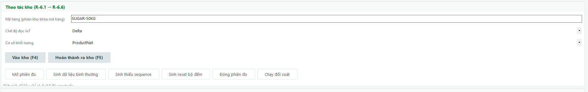

# Implementation Plan: Weighing Workflow Integration

## Overview

Tích hợp luồng cân end-to-end cho hệ thống cân hợp nhất TTC. Scope: tạo các interface/adapter mới (IQrScanHandler, IFrmSyncService, IWeighTicketPrintService, ISampleScaleGateway, IDeviceStatusMonitor), entity WeighTicket + migration, mở rộng presenter, bổ sung controls UI mới (DeviceStatusBar, WeighConditionChecklist, TimelineControl), redesign MeasurementSessionForm, và tích hợp tất cả vào các form hiện tại (WeighOperationForm, QualityForm, GateControlForm). Handlers nghiệp vụ cốt lõi giữ nguyên — chỉ gọi từ UI qua presenter.

## Tasks

- [x] 1. Application Abstractions — Tạo interfaces và records mới
  - [x] 1.1 Tạo IQrScanHandler interface và QrScanResult record
    - Tạo file `Application/Abstractions/IQrScanHandler.cs`
    - Định nghĩa `IQrScanHandler` với method `DecodeAndLookupAsync(string qrContent, Guid siteId, CancellationToken ct)`
    - Định nghĩa `QrScanResult` record theo thiết kế (IsSuccess, TripId, TripVersion, TripNo, Plate, TrailerPlate, CustomerOrOwner, Commodity, Warehouse, ShipmentNo, SugarcaneType, SugarcaneVariety, SugarcaneOwner, AssignedWeighbridgeId, AssignedWarehouseId, QrType, ErrorCode, ErrorMessage)
    - _Requirements: 1.1, 1.3, 1.4, 2.1, 6.1, 7.1_

  - [x] 1.2 Tạo IFrmSyncService interface và FrmSyncResult record
    - Tạo file `Application/Abstractions/IFrmSyncService.cs`
    - Định nghĩa `IFrmSyncService` với method `SyncTripInfoAsync(Guid tripId, Guid siteId, CancellationToken ct)`
    - Định nghĩa `FrmSyncResult` record (IsSuccess, SugarcaneType, SugarcaneVariety, SugarcaneOwner, HarvestMethod, Station, CropSeason, ErrorMessage)
    - _Requirements: 4.1, 12.1_

  - [x] 1.3 Tạo IWeighTicketPrintService interface và các record liên quan
    - Tạo file `Application/Abstractions/IWeighTicketPrintService.cs`
    - Định nghĩa `IWeighTicketPrintService` với methods `PrintAsync` và `GetAvailablePrintersAsync`
    - Định nghĩa `PrintTicketResult`, `PrinterConfig`, `PrinterInfo`, `WeighTicketData` records theo thiết kế
    - _Requirements: 5.1, 5.2, 5.3, 5.4, 5.5_

  - [x] 1.4 Tạo ISampleScaleGateway interface và SampleScaleSignal record
    - Tạo file `Application/Abstractions/ISampleScaleGateway.cs`
    - Định nghĩa `ISampleScaleGateway` với method `GetCurrentAsync(Guid sampleScaleId, CancellationToken ct)`
    - Định nghĩa `SampleScaleSignal` record (WeightKg, IsStable, StableDuration, DeviceStatus, OccurredAt)
    - _Requirements: 2.2, 2.3_

  - [x] 1.5 Tạo IDeviceStatusMonitor interface và DeviceStatus record
    - Tạo file `Application/Abstractions/IDeviceStatusMonitor.cs`
    - Định nghĩa `IDeviceStatusMonitor` với method `GetStatusAsync(Guid siteId, Guid? laneId, CancellationToken ct)`
    - Định nghĩa `DeviceStatus` record (DeviceId, DeviceCode, DeviceClass, IsOnline, ScaleStatus, LastSignalAt, SignalAge, FaultDescription)
    - _Requirements: 13.1, 13.2, 13.4_

- [x] 2. Application Queries — Tạo query interfaces mới
  - [x] 2.1 Tạo IWeighOperationQueries interface
    - Tạo file `Application/Queries/WeighOperationQueries.cs`
    - Định nghĩa `IWeighOperationQueries` với method `ListAsync(Guid siteId, Guid weighbridgeId, WeighedTripFilter filter, CancellationToken ct)`
    - Định nghĩa `WeighedTripRow` và `WeighedTripFilter` records theo thiết kế
    - _Requirements: 1.2, 4.6, 8.6_

  - [x] 2.2 Tạo IWarehouseQueries interface
    - Tạo file `Application/Queries/WarehouseQueries.cs`
    - Định nghĩa `IWarehouseQueries` với method `ListAsync(Guid warehouseId, WarehouseFilter filter, CancellationToken ct)`
    - Định nghĩa `WarehouseVehicleRow` và `WarehouseFilter` records theo thiết kế
    - _Requirements: 6.5_

- [x] 3. Application UseCases — Tạo UpdateSugarcaneTypeHandler
  - [x] 3.1 Tạo UpdateSugarcaneTypeHandler
    - Tạo file `Application/UseCases/Trips/UpdateSugarcaneTypeHandler.cs`
    - Implement `UpdateSugarcaneTypeCommand`, `UpdateSugarcaneTypeResult` records
    - Implement handler: validate trip exists, check không Cancelled, update SugarcaneType, kiểm tra đã Posted → tạo yêu cầu điều chỉnh, ghi audit log
    - Inject ITripRepository, IIntegrationMessageRepository, IUnitOfWork, IClock, ICurrentUser, IAuditLogger
    - _Requirements: 12.1, 12.2, 12.4_

- [x] 4. Domain — Tạo WeighTicket entity và mở rộng Trip
  - [x] 4.1 Tạo WeighTicket entity và thêm TicketNumber vào Trip
    - Tạo file `Domain/Entities/WeighTicket.cs` kế thừa AuditableEntity
    - Các trường: TripId, TicketNumber, TemplateCode, PrintedAt, PrintedBy, IsReprint, PrintCount, SnapshotJson
    - Thêm property `TicketNumber` (nullable string) vào `Trip` entity hiện tại
    - _Requirements: 5.1, 5.3_

- [x] 5. Checkpoint — Đảm bảo abstractions và domain đúng
  - Ensure all tests pass, ask the user if questions arise.

- [x] 6. Infrastructure — EF Core migration và repositories
  - [x] 6.1 Tạo EF Core migration AddWeighingWorkflowIntegration
    - Tạo migration mới trong `Infrastructure/Persistence/Migrations/`
    - Up(): CREATE TABLE `weigh_tickets` (id, trip_id, ticket_number, template_code, printed_at, printed_by, is_reprint, print_count, snapshot_json, created_at, created_by, updated_at, updated_by, version)
    - Up(): CREATE INDEX `idx_weigh_tickets_trip`, UNIQUE INDEX `uq_weigh_tickets_number` WHERE is_reprint = false
    - Up(): ALTER TABLE trips ADD COLUMN ticket_number varchar(50)
    - Down(): DROP TABLE weigh_tickets, ALTER TABLE trips DROP COLUMN ticket_number
    - _Requirements: 5.1_

  - [x] 6.2 Cấu hình EF Core cho WeighTicket entity
    - Thêm `DbSet<WeighTicket> WeighTickets` vào `WeighingDbContext`
    - Tạo `WeighTicketConfiguration` trong `Infrastructure/Persistence/Configurations/` (hoặc bổ sung vào ModuleConfigurations.cs)
    - Cấu hình mapping: snake_case columns, index, unique constraint
    - Cấu hình mapping cột `ticket_number` mới trên Trip
    - _Requirements: 5.1_

  - [x] 6.3 Tạo IWeighTicketRepository và EF implementation
    - Thêm `IWeighTicketRepository` vào `Application/Abstractions/` (hoặc ModuleRepositories.cs)
    - Implement `EfWeighTicketRepository` trong `Infrastructure/Repositories/`
    - Methods: GetByTripAsync, AddAsync, IncrementPrintCountAsync
    - _Requirements: 5.1, 5.3_

- [x] 7. Infrastructure — Adapter implementations
  - [x] 7.1 Tạo QrScanHandlerAdapter
    - Tạo file `Infrastructure/Adapters/QrScanHandlerAdapter.cs` implement `IQrScanHandler`
    - Logic: decode QR content → hash token → lookup QrToken trong DB → validate (hết hạn, thu hồi, QR tạm) → load Trip → build QrScanResult
    - Inject IQrTokenRepository, ITripRepository, IClock
    - _Requirements: 1.1, 1.3, 1.4_

  - [x] 7.2 Tạo FrmSyncAdapter
    - Tạo file `Infrastructure/Adapters/FrmSyncAdapter.cs` implement `IFrmSyncService`
    - Gọi FRM API endpoint để lấy thông tin cập nhật chuyến (SugarcaneType, SugarcaneVariety, SugarcaneOwner, HarvestMethod, Station, CropSeason)
    - Dùng typed HttpClient với timeout từ configuration
    - _Requirements: 4.1, 12.1_

  - [x] 7.3 Tạo WeighTicketPrintAdapter
    - Tạo file `Infrastructure/Adapters/WeighTicketPrintAdapter.cs` implement `IWeighTicketPrintService`
    - Tổng hợp WeighTicketData từ Trip + WeighEvent (Gross/Tare) + QualitySample (Impurity/CCS) + Site
    - Gọi System.Drawing.Printing hoặc reporting library để in phiếu
    - Ghi WeighTicket entity với SnapshotJson, đánh dấu IsReprint khi in lại
    - Lỗi in không ảnh hưởng dữ liệu cân
    - _Requirements: 5.1, 5.2, 5.3, 5.4, 5.5_

  - [x] 7.4 Tạo SampleScaleGatewayAdapter
    - Tạo file `Infrastructure/Adapters/SampleScaleGatewayAdapter.cs` implement `ISampleScaleGateway`
    - Đọc tín hiệu cân mẫu tại trạm lấy mẫu, trả SampleScaleSignal
    - _Requirements: 2.2, 2.3_

  - [x] 7.5 Tạo DeviceStatusMonitorAdapter
    - Tạo file `Infrastructure/Adapters/DeviceStatusMonitorAdapter.cs` implement `IDeviceStatusMonitor`
    - Poll trạng thái kết nối thiết bị: barcode reader, đồng hồ cân 1/2, camera LPR 1/2, camera toàn cảnh
    - Tính SignalAge từ LastSignalAt, xác định IsOnline
    - _Requirements: 13.1, 13.2, 13.4_

  - [x] 7.6 Tạo EfWeighOperationQueries và EfWarehouseQueries
    - Tạo file `Infrastructure/Queries/EfWeighOperationQueries.cs` implement `IWeighOperationQueries`
    - Query join trips + weigh_events + integration_messages cho lưới xe đã cân
    - Tạo file `Infrastructure/Queries/EfWarehouseQueries.cs` implement `IWarehouseQueries`
    - Query join trips + checkpoint_events + measurement_sessions cho danh sách xe trong/ra kho
    - _Requirements: 1.2, 6.5, 8.6_

- [x] 8. Infrastructure — Đăng ký DI
  - [x] 8.1 Cập nhật DependencyInjection.cs đăng ký services mới
    - Đăng ký IQrScanHandler → QrScanHandlerAdapter (Scoped)
    - Đăng ký IFrmSyncService → FrmSyncAdapter (typed HttpClient)
    - Đăng ký IWeighTicketPrintService → WeighTicketPrintAdapter (Scoped)
    - Đăng ký ISampleScaleGateway → SampleScaleGatewayAdapter (Scoped)
    - Đăng ký IDeviceStatusMonitor → DeviceStatusMonitorAdapter (Scoped)
    - Đăng ký IWeighOperationQueries → EfWeighOperationQueries (Scoped)
    - Đăng ký IWarehouseQueries → EfWarehouseQueries (Scoped)
    - Đăng ký IWeighTicketRepository → EfWeighTicketRepository (Scoped)
    - Đăng ký UpdateSugarcaneTypeHandler (Scoped)
    - _Requirements: 1.1, 2.2, 4.1, 5.1, 13.1_

- [x] 9. Checkpoint — Đảm bảo infrastructure biên dịch và migration chạy đúng
  - Ensure all tests pass, ask the user if questions arise.

- [x] 10. WinForms Controls — Tạo các custom controls mới
  - [x] 10.1 Tạo DeviceStatusBar control
    - Tạo file `WinForms/Controls/DeviceStatusBar.cs` kế thừa UserControl
    - Hiển thị trạng thái kết nối: Barcode 🟢/🔴, Đồng hồ cân 1 🟢/🔴, Đồng hồ cân 2 🟢/🔴, Camera LPR 1 🟢/🔴, Camera LPR 2 🟢/🔴, Camera toàn cảnh 🟢/🔴
    - Method `UpdateStatus(IReadOnlyList<DeviceStatus> devices)` cập nhật từ IDeviceStatusMonitor
    - Cập nhật mỗi 2 giây bằng Timer
    - Hiển thị FaultDescription khi lỗi, SignalAge khi mất tín hiệu
    - _Requirements: 13.1, 13.2, 13.4_

  - [x] 10.2 Tạo WeighConditionChecklist control
    - Tạo file `WinForms/Controls/WeighConditionChecklist.cs` kế thừa UserControl
    - Hiển thị checklist từng điều kiện chốt cân: QR hợp lệ ✓/✗, Vị trí AI ✓/✗, Cân ổn định ✓/✗, Điều kiện trước đã đủ ✓/✗
    - Method `UpdateFromDecision(WeighCommitDecision decision)` cập nhật từ DryRun result
    - Mỗi check hiển thị mã lỗi nếu chưa đạt
    - _Requirements: 1.2, 1.7_

  - [x] 10.3 Tạo TimelineControl cho mốc thời gian checkpoint
    - Tạo file `WinForms/Controls/TimelineControl.cs` kế thừa UserControl
    - Hiển thị timeline các mốc: Vào cổng → Cân lần 1 → Tạp chất → Cân lần 2 → Kho → Cổng ra
    - Mỗi mốc có: label, thời gian, trạng thái (✓ hoàn thành, ◯ chưa, ⊗ bỏ qua)
    - Method `UpdateCheckpoints(IReadOnlyList<CheckpointRow> checkpoints)` nhận dữ liệu từ queries
    - _Requirements: 7.1_

- [x] 11. WinForms Presenters — Tạo presenters mới
  - [x] 11.1 Tạo QualityPresenter
    - Tạo file `WinForms/Presenters/QualityPresenter.cs`
    - Inject IQrScanHandler, ISampleScaleGateway, RecordImpuritySampleHandler, ReceiveCcsResultHandler
    - Methods: ScanQrAsync, ReadSampleScaleAsync, RecordImpurityAsync, RecordCcsAsync
    - _Requirements: 2.1, 2.2, 2.3, 2.4, 3.1, 3.2_

  - [x] 11.2 Tạo WarehousePresenter
    - Tạo file `WinForms/Presenters/WarehousePresenter.cs`
    - Inject IQrScanHandler, OpenMeasurementSessionHandler, CloseMeasurementSessionHandler, ReconcileTripHandler, IWarehouseQueries
    - Methods: ScanQrAsync, ConfirmWarehouseEntryAsync, OpenSessionAsync, CloseSessionAsync, ConfirmWarehouseExitAsync, ListVehiclesAsync
    - _Requirements: 6.1, 6.2, 6.3, 6.4, 6.5, 6.6_

  - [x] 11.3 Tạo GatePresenter
    - Tạo file `WinForms/Presenters/GatePresenter.cs`
    - Inject IQrScanHandler, EvaluateGateHandler, ConfirmVehiclePassageHandler, ITripDetailQueries
    - Methods: ScanQrAsync, ConfirmExitAsync (EvaluateGate + ConfirmPassage), LoadTimelineAsync
    - _Requirements: 7.1, 7.2, 7.3, 7.4, 7.5_

  - [x] 11.4 Mở rộng WeighOperationPresenter với methods mới
    - Thêm dependencies: IQrScanHandler, IFrmSyncService, IWeighTicketPrintService, SubmitTripResultHandler, IWeighPreconditionQuery, IDeviceStatusMonitor, ApproveManualWeightHandler, RequestReweighHandler
    - Thêm methods: ScanQrAsync, SyncFrmAsync, CheckPreconditionsAsync, PrintTicketAsync, SyncErpAsync, ManualWeightAsync, RequestReweighAsync, GetDeviceStatusAsync
    - Giữ nguyên methods hiện tại: OpenSessionAsync, CommitAsync, ReadLiveWeightAsync
    - _Requirements: 1.1, 4.1, 5.1, 8.1, 10.3, 11.1_

- [x] 12. WinForms Helpers — PrintHelper
  - [x] 12.1 Tạo PrintHelper
    - Tạo file `WinForms/Helpers/PrintHelper.cs`
    - Hiển thị dialog chọn máy in (từ GetAvailablePrintersAsync), số bản in, template code
    - Gọi IWeighTicketPrintService.PrintAsync, xử lý lỗi in (không ảnh hưởng dữ liệu cân)
    - Đánh dấu bản in lại (isReprint = true) khi in lại
    - _Requirements: 5.1, 5.2, 5.3, 5.4_

- [x] 13. Checkpoint — Đảm bảo controls, presenters, helpers biên dịch
  - Ensure all tests pass, ask the user if questions arise.

- [x] 14. WeighOperationForm — Bổ sung QR scan, FRM sync, print, ERP sync, nhập tay, giám sát thiết bị
  - [x] 14.1 Tích hợp QR scan handler vào WeighOperationForm
    - Thay thế `IWeighWorkspaceProvider` bằng `IQrScanHandler` scan barcode event
    - Khi nhận barcode input: gọi `_presenter.ScanQrAsync(qrContent, siteId)`
    - Nếu QrScanResult.IsSuccess: điền thông tin chuyến, gọi OpenSessionAsync, bắt đầu poll
    - Nếu QR không hợp lệ/hết hạn/thu hồi: hiển thị mã lỗi + lý do, không mở phiên
    - Nếu QR tạm: hiển thị "Xe chưa đăng ký kế hoạch, cần quay lại cổng để lấy QR_chuyến"
    - Tự động chọn đúng bàn cân từ AssignedWeighbridgeId trong QrScanResult
    - _Requirements: 1.1, 1.3, 1.4, 1.5_

  - [x] 14.2 Tích hợp FRM sync và precondition check cho cân lần 2
    - Khi quét QR cho cân lần 2 (segmentIndex > 0): gọi `_presenter.SyncFrmAsync(tripId, siteId)` ngay sau scan
    - Cập nhật thông tin SugarcaneType, SugarcaneVariety, SugarcaneOwner từ FrmSyncResult
    - Gọi `_presenter.CheckPreconditionsAsync(tripId, role, segment)` để kiểm tra điều kiện
    - Nếu ImpuritySatisfied = false: chặn cân, hiển thị "Phải đo tạp chất trước"
    - Nếu CcsPending = true: hiển thị cảnh báo thiếu chữ đường (label warning), cho phép tiếp tục
    - _Requirements: 4.1, 4.2, 4.3_

  - [x] 14.3 Tích hợp WeighConditionChecklist và cập nhật hiển thị kết quả cân lần 2
    - Thêm WeighConditionChecklist control vào panel giữa form cân
    - Cập nhật checklist từ DryRun result (conditionTimer) mỗi 800ms
    - Sau chốt cân lần 2 thành công: hiển thị TL hàng (NetKg), bật nút In phiếu (F6) và nút Sync
    - Khi chốt cân lần 2 hoàn thành + đủ lượt cân → WeighingCompleted
    - _Requirements: 1.2, 1.6, 1.7, 1.8, 4.4, 4.6, 4.7_

  - [x] 14.4 Tích hợp nút In phiếu (F6) sử dụng PrintHelper
    - Kết nối _btnPrint click event → gọi PrintHelper hiển thị dialog chọn máy in → gọi _presenter.PrintTicketAsync
    - Chỉ bật sau cân lần 2 thành công
    - In lại đánh dấu IsReprint + ghi audit
    - Lỗi in hiển thị thông báo, không ảnh hưởng dữ liệu
    - _Requirements: 5.1, 5.2, 5.3, 5.4_

  - [x] 14.5 Tích hợp nút Sync ERP
    - Thêm nút "Sync ERP" vào action bar, bật sau cân lần 2 + đối soát đạt
    - Click → gọi _presenter.SyncErpAsync(SubmitTripResultCommand)
    - Hiển thị trạng thái đồng bộ (Held nếu D-02 chưa xác minh, New nếu sẵn sàng)
    - _Requirements: 8.1, 8.2, 8.3, 8.6_

  - [x] 14.6 Tích hợp nút Nhập tay số cân
    - Thêm nút "Nhập tay" vào form, chỉ hiển thị khi user có quyền `weighing.weight.manual`
    - Click → dialog nhập: số cân, đơn vị, lý do (bắt buộc), phê duyệt (bắt buộc)
    - Gọi _presenter.ManualWeightAsync(ApproveManualWeightCommand)
    - Từ chối nếu Trip đang Paused hoặc có Unknown transaction
    - Ghi audit log đầy đủ
    - _Requirements: 11.1, 11.2, 11.3, 11.4, 11.5_

  - [x] 14.7 Tích hợp DeviceStatusBar và giám sát thiết bị realtime
    - Thay thế StatusStrip hiện tại bằng DeviceStatusBar control
    - Poll IDeviceStatusMonitor mỗi 2 giây qua _presenter.GetDeviceStatusAsync
    - Hiển thị "---" + thời gian mất tín hiệu khi đầu cân không phản hồi
    - Hiển thị thời gian ổn định dạng đếm ngược trên WeighDisplayControl (ví dụ "Ổn định 3.2s / 5.0s")
    - Hiển thị trạng thái lỗi cụ thể (Fault, Overload, Underload) trên thanh trạng thái
    - _Requirements: 13.1, 13.2, 13.3, 13.4_

  - [x] 14.8 Tích hợp lưới xe đã cân sử dụng IWeighOperationQueries
    - Kết nối _dgvWeighed với IWeighOperationQueries.ListAsync qua presenter
    - Filter theo ngày (dtpFrom, dtpTo), tab Cân vào / Cân cả vào và ra
    - Hiển thị cột SyncStatus từ IntegrationMessageStatus
    - Refresh sau mỗi lần chốt cân
    - _Requirements: 1.2, 8.6_

- [x] 15. QualityForm — Tích hợp QR scan và auto-weigh tạp chất
  - [x] 15.1 Tích hợp QR scan và auto-weigh tạp chất vào QualityForm
    - Thay thế ComboBox chọn chuyến bằng barcode scan input + QualityPresenter.ScanQrAsync
    - Hiển thị thông tin chuyến mía: Biển số, Chủ mía, Loại mía, Giống mía từ QrScanResult
    - Tích hợp ISampleScaleGateway: auto-read cân mẫu, chờ ổn định 3-5 giây, tự động ghi SampleBeforeKg/SampleAfterKg
    - Workflow 2 bước: Đặt mẫu 1 → chờ ổn định → ghi → Đặt mẫu 2 → chờ ổn định → ghi → tính tạp chất
    - Hiển thị cảnh báo mẫu dưới ngưỡng (BelowMinimumSampleWarning)
    - Từ chối khi mẫu sau > mẫu trước
    - Hỗ trợ nhập tay khi có quyền quality.impurity.manual (bắt buộc lý do + phê duyệt)
    - _Requirements: 2.1, 2.2, 2.3, 2.4, 2.5, 2.6, 2.7, 2.8, 3.1, 3.2, 3.3, 3.4, 3.5_

- [x] 16. MeasurementSessionForm — Redesign cho luồng vào/ra kho
  - [x] 16.1 Redesign MeasurementSessionForm với QR scan và checkpoint tracking
    - Thay thế ComboBox chọn chuyến bằng barcode scan input + WarehousePresenter.ScanQrAsync
    - Thêm panel thông tin chuyến (Biển số, Hàng hóa, Kho, Trạng thái) từ QrScanResult
    - Thêm nút "Vào kho (F4)": ghi CheckpointEvent loại WarehouseIn
    - Thêm nút "Hoàn thành ra kho (F5)": ghi CheckpointEvent loại WarehouseOut, hướng dẫn đến bàn cân lần 2
    - Giữ nguyên logic Mở phiên đo / Đóng phiên đo / Đối soát hiện tại
    - Xử lý xe ra kho khi chưa hoàn thành: yêu cầu lý do + WaiverReason nếu được phê duyệt
    - Thêm lưới danh sách xe từ IWarehouseQueries: tab [Trong kho] và [Đã ra kho], filter ngày
    - Thêm panel thông báo theo thiết kế (RichTextBox logs)
    - Bố cục theo wireframe trong thiết kế (UI-04 redesign)
    - _Requirements: 6.1, 6.2, 6.3, 6.4, 6.5, 6.6_

- [x] 17. GateControlForm — Bổ sung xác minh hoàn thành và QR scan
  - [x] 17.1 Tích hợp QR scan, timeline, và xác minh hoàn thành vào GateControlForm
    - Thay thế lookup thủ công bằng barcode scan input + GatePresenter.ScanQrAsync
    - Hiển thị thông tin chuyến + mốc thời gian (TimelineControl): TG vào cổng, TG cân 1, TG cân 2, TG ra cổng
    - Kiểm tra Trip.Lifecycle: nếu Reconciled/Posted/Closed → "Xe đã hoàn thành cân. Xác nhận cho xe qua!"
    - Nếu chưa đủ checkpoint → từ chối + danh sách bước chưa hoàn thành
    - Kiểm tra lệnh treo: nếu có GateCommand Unknown/Requested chưa hết hạn → từ chối phát lệnh mới
    - Xác nhận (F6) → EvaluateGateHandler → mở barie 30s → ConfirmVehiclePassageHandler → thu hồi QR → Closed
    - Ghi audit log khi xe ra cổng thành công
    - Hiển thị lưới xe trong nhà máy / đã ra cổng với tab filter + bộ lọc ngày
    - _Requirements: 7.1, 7.2, 7.3, 7.4, 7.5, 7.6, 7.7_

- [x] 18. Checkpoint — Đảm bảo tất cả form tích hợp đúng
  - Ensure all tests pass, ask the user if questions arise.

- [x] 19. WeighOperationPresenter — Tích hợp cân lại sau sự cố
  - [x] 19.1 Tích hợp cân lại sau sự cố vào form cân
    - Thêm nút "Cân lại" trên WeighOperationForm, chỉ hiện khi có quyền `weighing.reweigh.request`
    - Click → dialog chọn vai trò cân (Gross/Tare), nhập lý do bắt buộc, đính kèm tài liệu sự cố
    - Gọi _presenter.RequestReweighAsync(RequestReweighCommand)
    - Nếu đã Posted → thông báo REWEIGH_AFTER_POST, yêu cầu tạo yêu cầu điều chỉnh
    - Nếu Trip đang Paused → yêu cầu Resume trước (xác nhận kiểm tra kết nối, vị trí xe, Unknown transactions)
    - Sau cân lại → hiển thị thông báo cần chạy lại đối soát
    - _Requirements: 10.1, 10.2, 10.3, 10.4, 10.5, 10.6_

- [x] 20. TripDetailForm — Bổ sung phân bổ ghép xe và timeline
  - [x] 20.1 Bổ sung hiển thị phân bổ ghép xe và timeline trên TripDetailForm
    - Thêm TimelineControl vào header form, hiển thị mốc thời gian từ checkpoint queries
    - Đảm bảo tab Phân bổ hiển thị đúng: chủ mía, trọng lượng phân bổ, tỷ lệ, phần dư làm tròn, trạng thái duyệt
    - Thêm nút "Phân bổ" trên tab Phân bổ: mở dialog chọn phương pháp (ApprovedRatio / FixedQuantityWithRemainder)
    - Validate: net âm/bằng 0 → từ chối, bắt buộc ApprovalRef, tổng phân bổ bảo toàn tổng thực tế
    - Hiển thị RoundingAdjustmentKg minh bạch trên từng dòng
    - _Requirements: 9.1, 9.2, 9.3, 9.4, 9.5, 9.6_

- [x] 21. Development — Cập nhật Preview services cho các adapter mới
  - [x] 21.1 Cập nhật PreviewServices/SimulatedDevices cho adapter mới
    - Thêm simulated implementations cho IQrScanHandler, IFrmSyncService, ISampleScaleGateway, IDeviceStatusMonitor, IWeighTicketPrintService trong Development/ folder
    - Đăng ký simulated services trong chế độ xem trước (PreviewDataStore)
    - Đảm bảo chế độ xem trước hoạt động end-to-end: quét QR giả → load trip → cân → in → sync
    - _Requirements: 1.1, 2.2, 4.1, 5.1, 13.1_

- [x] 22. Checkpoint — Đảm bảo tất cả form và luồng hoạt động end-to-end
  - Ensure all tests pass, ask the user if questions arise.

- [x] 23. Tests — Unit tests cho các components mới
  - [x] 23.1 Viết unit tests cho QrScanHandlerAdapter
    - Test: QR hợp lệ → trả IsSuccess + thông tin chuyến
    - Test: QR hết hạn → trả ErrorCode + ErrorMessage
    - Test: QR đã thu hồi → trả ErrorCode
    - Test: QR tạm → trả QrType = Temp, IsSuccess = false
    - Test: QR không decode được → trả lỗi cụ thể
    - _Requirements: 1.1, 1.3, 1.4_

  - [x] 23.2 Viết unit tests cho UpdateSugarcaneTypeHandler
    - Test: cập nhật thành công → ghi audit, trả OldValue/NewValue
    - Test: trip đã Posted → RequiresAdjustmentRequest = true
    - Test: trip đã Cancelled → từ chối
    - _Requirements: 12.1, 12.2, 12.4_

  - [x] 23.3 Viết unit tests cho WeighOperationPresenter methods mới
    - Test: ScanQrAsync delegates đúng đến IQrScanHandler
    - Test: SyncFrmAsync delegates đúng đến IFrmSyncService
    - Test: PrintTicketAsync delegates đúng đến IWeighTicketPrintService
    - Test: ManualWeightAsync delegates đúng đến ApproveManualWeightHandler
    - _Requirements: 1.1, 4.1, 5.1, 11.1_

- [x] 24. Final checkpoint — Đảm bảo tất cả tests pass và solution biên dịch
  - Ensure all tests pass, ask the user if questions arise.

## Notes

- Tasks marked with `*` are optional and can be skipped for faster MVP
- Each task references specific requirements for traceability
- Checkpoints ensure incremental validation
- Handlers nghiệp vụ cốt lõi (EvaluateAndCommitWeightHandler, GateHandlers, QualityHandlers, MeasurementSessionHandlers, ReconcileTripHandler, AllocateTripHandler, SubmitTripResultHandler, ExceptionHandlers) giữ nguyên — chỉ tích hợp vào UI qua presenter
- Domain rules (WeighCommitRules, GateDecisionRules, ReconciliationRules, ImpurityCalculator, NetWeightCalculator) giữ nguyên
- Mọi quyết định nghiệp vụ do server-side (Application/Domain) quyết định, UI chỉ hiển thị kết quả
- Form cân không tự tính toán điều kiện chốt cân (R-007)
- Lỗi in không ảnh hưởng dữ liệu cân đã lưu
- Số cân lưu decimal (numeric(15,3)), không dùng double/float

## Task Dependency Graph

```json
{
  "waves": [
    { "id": 0, "tasks": ["1.1", "1.2", "1.3", "1.4", "1.5", "2.1", "2.2"] },
    { "id": 1, "tasks": ["3.1", "4.1"] },
    { "id": 2, "tasks": ["6.1", "6.2", "6.3"] },
    { "id": 3, "tasks": ["7.1", "7.2", "7.3", "7.4", "7.5", "7.6"] },
    { "id": 4, "tasks": ["8.1"] },
    { "id": 5, "tasks": ["10.1", "10.2", "10.3"] },
    { "id": 6, "tasks": ["11.1", "11.2", "11.3", "11.4", "12.1"] },
    { "id": 7, "tasks": ["14.1", "15.1", "16.1", "17.1"] },
    { "id": 8, "tasks": ["14.2", "14.3", "14.7", "14.8"] },
    { "id": 9, "tasks": ["14.4", "14.5", "14.6", "19.1", "20.1"] },
    { "id": 10, "tasks": ["21.1"] },
    { "id": 11, "tasks": ["23.1", "23.2", "23.3"] }
  ]
}
```
